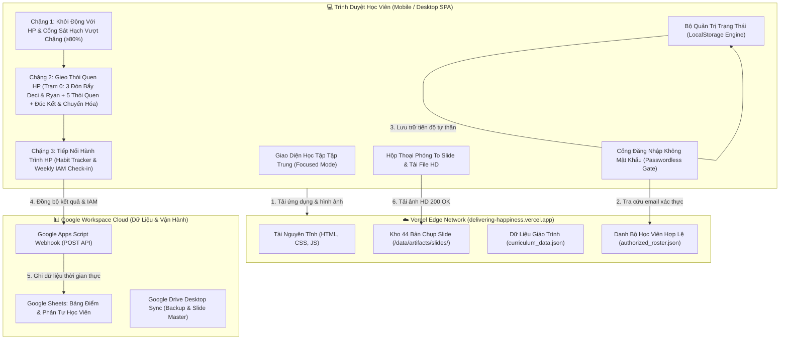
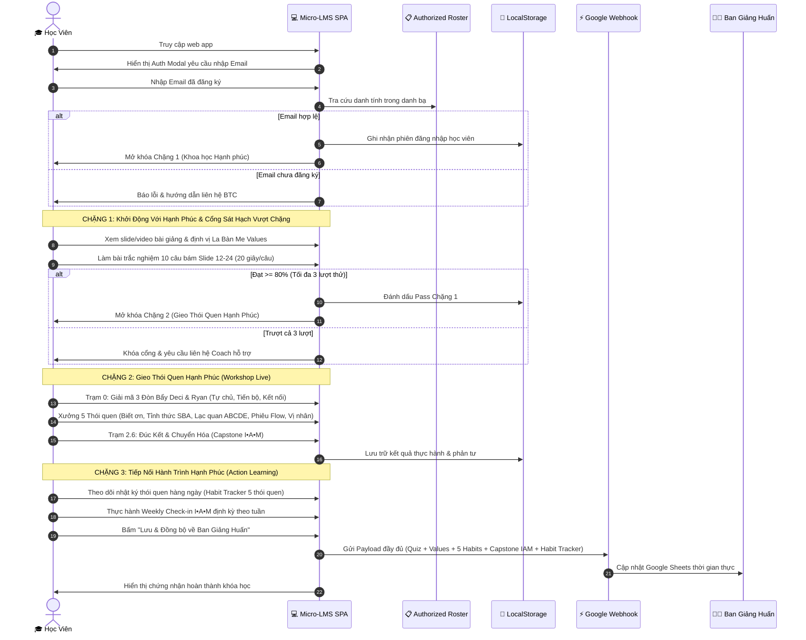
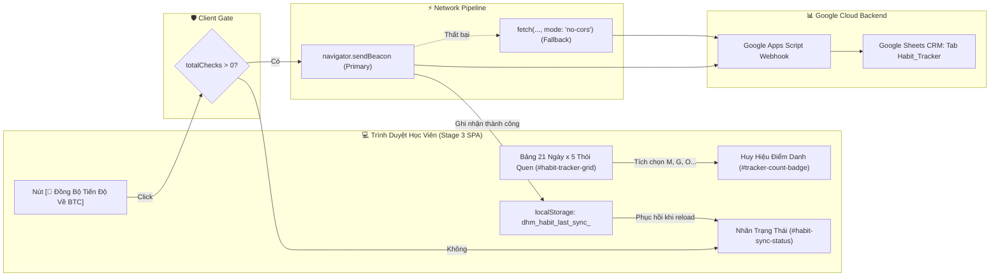
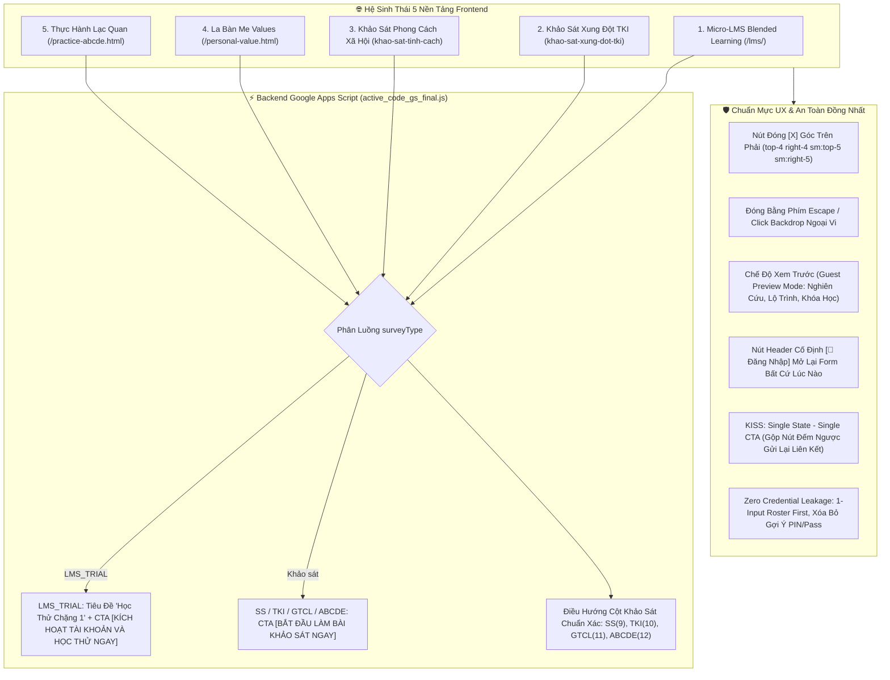

# Kiến Trúc Hệ Thống (System Architecture) — Delivering Happiness Blended Learning LMS

Tài liệu này mô tả chi tiết kiến trúc kỹ thuật, luồng dữ liệu, ranh giới an toàn và các tích hợp ngoại vi của hệ thống Micro-LMS Blended Learning 3 Chặng thuộc dự án Delivering Happiness (DHM).

---

## 1. Sơ Đồ Kiến Trúc Tổng Thể (High-Level Architecture)

Hệ thống được thiết kế theo mô hình **Serverless Jamstack Micro-LMS**:
- Giao diện đơn trang (Single Page Application - SPA) siêu nhẹ viết bằng HTML5/CSS3/Vanilla JavaScript chuẩn ES6+.
- Lưu trữ trạng thái cục bộ tại trình duyệt qua `localStorage` kết hợp đồng bộ đa kênh về Google Sheets thông qua Google Apps Script Webhook.
- Toàn bộ tài nguyên tĩnh (HTML, CSS, JS, Slide Infographics PNG, Data JSON) được lưu trữ và phân phối qua mạng phân phối nội dung (CDN) của Vercel.



---

## 2. Luồng Trải Nghiệm Học Tập 3 Chặng (3-Stage Pedagogical Flow)

Mô hình sư phạm kết hợp (Blended Learning) liên kết chặt chẽ giữa học trực tuyến trước khóa học, thực hành trực tiếp tại lớp và đồng hành chuyển hóa sau khóa học:



---

## 3. Kiến Trúc Dữ Liệu & Ranh Giới An Toàn (Data & Security)

### A. Ranh Giới Xác Thực & Hệ Thống Quản Trị Mật Khẩu 4 Tầng (Authentication & 4-Tier Password Hierarchy)
- Học viên tra cứu danh tính qua địa chỉ Email hoặc Số điện thoại đối chiếu với `authorized_roster.json`.
- Hệ thống quản trị mật khẩu 4 tầng bảo vệ quyền truy cập:
  1. **Tầng 1 (Apollo Enterprise Force-Change):** Tài khoản doanh nghiệp (Apollo) có mật khẩu khởi tạo mặc định `1234`. Khi đăng nhập lần đầu, hệ thống bắt buộc mở modal đổi mật khẩu (`#change-pass-modal`) và chặn truy cập LMS cho đến khi học viên cập nhật mật khẩu mới (tối thiểu 4 ký tự). Mật khẩu mới được băm bằng Web Crypto API SHA-256 (`crypto.subtle.digest("SHA-256")`) và lưu tại `dhm_lms_pass_<identity>`.
  2. **Tầng 2 (Self-Service Change Password):** Học viên có thể chủ động đổi mật khẩu qua modal cài đặt bất kỳ lúc nào.
  3. **Tầng 3 (Emergency Master Bypass PIN):** Mã PIN khẩn cấp `8888` cho phép Ban Giảng Huấn / Kỹ thuật viên truy cập hỗ trợ học viên khi gặp sự cố quên mật khẩu.
  4. **Tầng 4 (Legacy Phone Last 4):** Đối với học viên cũ có số điện thoại trong danh bạ, 4 số cuối SĐT tiếp tục hoạt động như mật khẩu mặc định nếu chưa đổi.
- Thông tin nhạy cảm của người dùng (PII) được cách ly; chỉ lưu trữ mã học viên, lớp học (cohort) và email công vụ trên trình duyệt.

### B. Lưu Trữ Ngoại Tuyến & Phòng Chống Mất Dữ Liệu (Local-First Resilience)
- Mọi thao tác gõ phản tư (reflection textarea) và tích chọn trắc nghiệm đều được kích hoạt cơ chế `debouncedSave(500ms)` tự động lưu vào `localStorage`.
- Nếu học viên mất kết nối mạng (offline) giữa chừng, dữ liệu vẫn được bảo tồn nguyên vẹn và tự động đồng bộ khi có kết nối trở lại.

### C. Cơ Chế Phân Phối Tài Nguyên Hình Ảnh (CDN Asset Pipeline)
- 44 bản chụp slide bài giảng chính thức được lưu trữ tập trung tại đường dẫn gốc `/data/artifacts/slides/slide_XX.png`.
- Toàn bộ đường dẫn tải ảnh và hiển thị lightbox trong mã nguồn `app.js` đều được chuẩn hóa tuyệt đối với tiền tố `/` để chống lỗi 404 khi truy cập từ các đường dẫn lồng nhau (`/lms/`, `/lms/index.html`).

### D. Chuẩn Hóa Khóa Dữ Liệu Học Viên & Phòng Thủ Xung Đột (Identity Property & Key Collision Guard)
- **Chuẩn hóa danh tính trong `findLearner()`:** Đảm bảo đối tượng học viên luôn có trường `identity = match.email || match.phone || match.learner_id`, ngăn chặn triệt để trường hợp `identity` mang giá trị `undefined`.
- **Cơ chế fallback đa tầng tại bộ nhớ:** Trong `saveLearnerProgress()` và `applyUserSession()`, khóa lưu trữ luôn được bảo vệ qua cú pháp:
  ```javascript
  const idKey = currentUser.identity || currentUser.email || currentUser.learner_id || "guest";
  const progressKey = `dhm_lms_progress_${idKey}`;
  ```
- **Chống xung đột khóa (Anti-Collision):** Loại bỏ hoàn toàn lỗi suy biến khóa thành `dhm_lms_progress_undefined`, đảm bảo tiến độ học tập của từng học viên được phân lập an toàn và nạp chính xác sau khi tải lại trang (F5/Reload).

---

## 4. Ranh Giới Môi Trường & Triển Khai (Environments)

| Thành phần | Môi Trường Local | Môi Trường Staging | Môi Trường Live Production |
| :--- | :--- | :--- | :--- |
| **Mã Nguồn Web** | `http://localhost:3000/lms/` | Vercel Preview Deployments | `https://delivering-happiness.vercel.app/lms/` |
| **Kho Lưu Trữ Git** | `C:\...\dh4hn-website` | Nhánh tính năng / PR | `origin/main` (GitHub) |
| **Database CSDL** | `localStorage` trình duyệt | Mock payload / Sandbox sheet | Google Sheets Production (Apps Script API) |
| **Kho Ảnh Slides** | 44 files PNG trong `data/artifacts/slides/` | Vercel Asset Storage | Vercel Global Edge CDN (HTTP 200 OK) |

---

## 5. Kiến Trúc Đồng Bộ Thói Quen 21 Ngày Về CRM Webhook (21-Day Habit Tracker Sync CRM)

Phân hệ theo dõi và đồng bộ thói quen đảm bảo học viên duy trì 5 thói quen hạnh phúc cốt lõi (Tỉnh thức, Biết ơn, Vị nhân, Phiêu, Lạc quan) và gửi tiến độ về Ban Giảng Huấn:



### Đặc tả Payload `sync_habit_tracker`:
```json
{
  "action": "sync_habit_tracker",
  "learner_id": "DHM-XXXX",
  "name": "Họ và Tên",
  "email": "user@domain.com",
  "phone": "0901234567",
  "cohort": "DHM10",
  "sync_timestamp": "2026-10-05T03:39:00.000Z",
  "habit_tracker": {
    "day_1": { "m": true, "g": true, "o": true, "f": false, "a": false },
    "day_2": { "m": false, "g": false, "o": false, "f": false, "a": false }
  },
  "streak_stats": {
    "current_streak": 1,
    "longest_streak": 1,
    "total_days_active": 1,
    "total_checks": 3,
    "completion_percent": 2.9
  },
  "weekly_checkins": { "w1": "Phản tư tuần 1..." }
}
```

---

## 6. Kiến Trúc Bộ Đọc Cẩm Nang & Render Ảnh Trực Quan (In-App Document Reader & Visual Pipeline)

Nhằm tối ưu hóa trải nghiệm học viên không cần rời khỏi nền tảng LMS để đọc tài liệu hướng dẫn:
- **Client-side Markdown Parser:** Hàm `renderSimpleMarkdown` trong `lms/app.js` hỗ trợ toàn diện cú pháp Markdown chuẩn (Headings, Tables, Lists, Quotes, Code, Links) và thẻ ảnh ``.
- **Image Asset Delivery:** Toàn bộ ảnh chụp giao diện được lưu trữ tại `/data/artifacts/images/` và phân phối qua Vercel Global Edge CDN, hiển thị tự động trong modal `#doc-reader-modal` với định dạng bo góc tròn (`rounded-2xl`) và đổ bóng chiều sâu (`shadow-2xl`).
- **Deep Linking:** Nút `#btn-open-habit-full-doc` tích hợp ngay trong Accordion Hướng Dẫn của Bảng Điểm Danh Chặng 3, giúp học viên nhấp 1 phát là mở ngay Phần V của Cẩm nang học tập.

---

## 7. Kiến Trúc Đồng Bộ Tự Động Khi Mở Trang & Thu Hồi Toàn Diện Checkpoints I•A•M (Auto-Sync Telemetry on Boot & Full I•A•M Recovery Pipeline)

Nhằm đảm bảo 100% bài làm trắc nghiệm (Quiz), Giá trị cốt lõi (Me Values), các bộ thẻ phản tư Check point 1 & 2 (`stage1_iam_cp1_sets`, `stage1_iam_cp2_sets`), Ghi chú nhanh (`quick_notes`) và 5 Trạm Thu Hoạch (`team-happiness-iam`) lưu trong `localStorage` của học viên đều được đẩy về Google Sheets mà không cần thao tác bấm nút thủ công:

```mermaid
graph TD
    subgraph ClientApps["💻 Trình Duyệt Học Viên (LMS & 5-Station IAM App)"]
        Boot["Sự kiện Mở Trang (applyUserSession) / Chuyển Tab (window.focus)"]
        Extract["extractIamAndNotesTelemetry(prog, identity)"]
        HashCheck{"So khớp stateHash với dhm_telemetry_last_hash_<id>?"}
        Jitter["Hàng đợi Jitter ngẫu nhiên (1000ms - 4000ms) + Single-Flight Lock"]
        Dispatch["dispatchTelemetryPayload (sendBeacon Primary -> fetch Fallback)"]
        IamBoot["flushPendingIamOnBoot (team-happiness-iam)"]
    end

    subgraph GASBackend["⚡ Google Apps Script Webhook (@78)"]
        DoPost["doPost(e) -> handleLmsAndIamTelemetry_(body)"]
        DoGet["doGet(e) -> handleGetLmsIamSubmissions_(params)"]
    end

    subgraph Sheets["📊 Google Sheets Đích (Production)"]
        ApolloSheet["Sheet Apollo (1Ju4y-KNDe7eiMvpbyq2mPfKTijH_1NIC3j8Rykl7cak)"]
        TabSummary["Tab 1: Tổng Hợp Học Viên (Upsert theo Email)"]
        TabLogs["Tab 2: Nhật Ký Từng Trạm (Khử trùng lặp theo Email + Station + I/A/M)"]
        TabLms["Tab 3: Thu Hoạch LMS & Checkpoints (CP1/CP2 Multi-Sets, Quiz, Me Values, Notes)"]
        MainSheet["Sheet CRM Chính DHM (1ZToRX6J5Vo6UgHzYEE_eUxU0bVnsGxBRLt-8tduI5CA)"]
    end

    Boot --> Extract --> HashCheck
    HashCheck -->|Khác Hash (Có dữ liệu mới/chưa đồng bộ)| Jitter --> Dispatch
    HashCheck -->|Trùng Hash| Skip["Bỏ qua (Idempotent Guard)"]
    IamBoot --> DoPost
    Dispatch --> DoPost
    DoPost --> ApolloSheet
    ApolloSheet --> TabSummary
    ApolloSheet --> TabLogs
    ApolloSheet --> TabLms
    DoPost --> MainSheet
    DoGet --> ApolloSheet
```

### Các Cơ Chế Phòng Vệ Kỹ Thuật Cốt Lõi:
1. **Đơn nhất hóa kênh vận chuyển (`dispatchTelemetryPayload`):** Sử dụng `navigator.sendBeacon(url, new Blob([json], { type: 'text/plain;charset=utf-8' }))` làm kênh chính và chỉ gọi `fetch(..., { mode: 'no-cors', keepalive: true })` khi `sendBeacon` trả về `false`, loại bỏ hoàn toàn hiện tượng nhân đôi bản ghi (Duplicate Rows) do gọi đồng thời cả hai phương thức.
2. **Chữ ký trạng thái chống trùng lặp (`Idempotent State Hash`):** Chuỗi `stateHash` kết hợp điểm Quiz, danh sách Me Values, dữ liệu ABCDE và chữ ký `__iam:${iamTelemetry.iamSignature}` (tính từ toàn bộ các bộ thẻ `cp1_sets`, `cp2_sets`, `stage1_iam_1_1..1_3`, `stage2_habits`, `stage2_capstone_sets`, `quick_notes`). Chỉ khi học viên có thay đổi mới hoặc có dữ liệu cũ trong `localStorage` chưa từng có hậu tố `__iam:`, hệ thống mới kích hoạt gửi mạng.
3. **Chống nghẽn đồng thời tại lớp học (`Jitter & Single-Flight Lock`):** Khi cả lớp mở máy cùng lúc tại hội trường, độ trễ ngẫu nhiên `1000ms–4000ms` rải đều các request, kết hợp cờ khóa `isAutoTelemetryInFlight` ngăn chặn việc bắn chồng chéo khi người dùng chuyển tab liên tục.
4. **An toàn phân quyền Google Sheets (`Container Exception Guard`):** Trong Google Apps Script V8, lệnh `SpreadsheetApp.openById(...)` trên một bảng tính chưa cấp quyền cho chủ sở hữu Web App sẽ làm sập toàn bộ tiến trình ở tầng Container (không bắt được bằng `try/catch` thông thường). Do đó, mọi bảng tính đích ngoại vi (như `1Ju4y-KNDe7eiMvpbyq2mPfKTijH_1NIC3j8Rykl7cak`) bắt buộc phải được cấp quyền `writer` trước khi gắn vào Webhook.

---

## 8. Kiến Trúc An Ninh & Phòng Vệ Bảo Mật P0 (P0 Security & Access Control Architecture)

Cập nhật và hoàn thiện ngày 12/10/2026 sau khi vá triệt để 6 lỗ hổng bảo mật cấp bách P0:

1. **Xác thực Cổng Quản trị qua Băm SHA-256 Web Crypto (`Client-Side PIN Hashing`):**
   - Không lưu trữ mật khẩu hay mã PIN quản trị ở dạng văn bản thuần (`plaintext`) trong mã nguồn JavaScript.
   - Sử dụng Web Crypto API (`crypto.subtle.digest('SHA-256', ...)`) để băm chuỗi người dùng nhập trước khi so khớp với giá trị băm chuẩn (`158a323a7ba44870f23d96f1516dd70aa48e9a72db4ebb026b0a89e212a208ab`).
   - Gỡ bỏ hoàn toàn mọi tham số vượt rào qua URL (`?coach_unlocked=true`, `?pin=2026`).

2. **Khóa Chặt Lỗ Hổng Stored XSS Đa Tầng (`Sanitization via escapeHTML`):**
   - Xây dựng cơ chế escape HTML chuẩn hóa đối với mọi ký tự nhạy cảm (`&`, `<`, `>`, `"`, `'`).
   - Bọc toàn bộ các trường hiển thị động lấy từ bộ nhớ hoặc dữ liệu học viên (Họ tên, Cơ sở, Phòng ban, Khóa học, Thẻ trạm, Danh sách giá trị sống Me-We, Bài tập phản tư nghịch cảnh ABCDE).
   - Đảm bảo 100% không cho phép tiêm mã script độc hại vào DOM khi xem Dashboard hoặc mở Modal chi tiết.

3. **Cách Ly Tài Nguyên CORS (Cross-Origin Resource Sharing Isolation):**
   - Gỡ bỏ hoàn toàn cấu hình wildcard `Access-Control-Allow-Origin: *` trên tệp `authorized_roster.json` trong `vercel.json`.
   - Ngăn chặn triệt để các website của bên thứ ba cào trộm danh bạ học viên.

4. **Triệt Tiêu Cơ Chế Vượt Rào Cục Bộ & Mật Khẩu Khẩn Cấp:**
   - Xóa bỏ việc kiểm tra quyền học viên qua bộ nhớ trình duyệt `localStorage.getItem("DHM10_lastPaymentStatus")`. Trạng thái thanh toán và mở trạm bắt buộc phải căn cứ vào danh sách Roster chuẩn từ máy chủ.
   - Gỡ bỏ hoàn toàn mã PIN khẩn cấp `8888` trong hàm xác thực mật khẩu `verifyPassword`.

5. **Bảo Vệ Dữ Liệu Cá Nhân Tuân Thủ Nghị Định 13/2023/NĐ-CP:**
   - 100% dữ liệu dùng cho chức năng Demo / Dữ liệu mẫu trên Dashboard được thay thế bằng danh sách giả lập (`test.learnerX@example.com`, `090000000X`).
   - Không lưu trữ hoặc hiển thị thông tin định danh cá nhân (PII) thật trong mã nguồn công khai.

---

## 9. Kiến Trúc Ứng Dụng Thu Hoạch 6 Trạm I•A•M Apollo v2 & Dashboard Giảng Viên 18 Cột (`team-happiness-iam-v2`)

Được thiết kế phục vụ chuyên biệt cho lớp học Apollo và các cohort quy mô lớn:
1. **Chuẩn Hóa Nhận Diện & Trải Nghiệm Sư Phạm:**
   - Thương hiệu chuẩn hóa: `TEAM HAPPINESS` (thay thế cho nhận diện cũ).
   - Hero Copy thân thiện, trong sáng, hướng dẫn học viên nhập trực tiếp cảm nhận & hành động vào 6 Trạm theo tiến độ lớp.
   - Loại bỏ 100% từ ngữ bịa đặt (`DEDICATED`) và thông báo kỹ thuật (`Đồng bộ Sheet cũ`).
2. **Dashboard Giảng Viên 18 Cột Chống Bẹp Trên Mobile:**
   - Cột cố định tên học viên: Rộng `180px`.
   - 18 Cột Trạm (6 Trạm x 3 khía cạnh I - A - M): Rộng cố định `155px` (`w-[155px] min-w-[155px]`), sử dụng `line-clamp-3` để hiển thị tối đa 3 dòng nội dung.
   - Tổng chiều rộng bảng cố định `3.210px` kết hợp `table-layout: fixed`.
   - Cơ chế Responsive: Gỡ bỏ thuộc tính `sticky` trên màn hình di động (< 768px), cho phép người dùng cuộn ngang bảng ma trận tự do mà không bị cột tên che khuất hoặc đè bẹp 18 cột còn lại.
3. **Đồng Bộ Dữ Liệu Trực Tiếp:**
   - Nhận diện dữ liệu qua Roster và đồng bộ thời gian thực về Google Apps Script Webhook `@79` ghi vào Sheet Apollo (`1Ju4y-KNDe7eiMvpbyq2mPfKTijH_1NIC3j8Rykl7cak`).

---

## 10. Cơ Chế Tạm Dừng An Toàn & Chuyển Hướng IAM v1 (`team-happiness-iam`) Đến 20/10/2026

1. **Bảo Toàn Phiên Bản Full Gốc:**
   - Tạo điểm phục hồi Git Tag: `backup_iam1_full_pre_pause_20261012`.
2. **Cờ Kiểm Soát Chuyển Hướng (`IS_TEMPORARILY_PAUSED_FOR_APOLLO`):**
   - Đặt cờ `IS_TEMPORARILY_PAUSED_FOR_APOLLO = true` trong `src/App.tsx`.
   - Khi học viên truy cập `https://team-happiness-iam.vercel.app`, hệ thống hiển thị màn hình thông báo tạm dừng sang trọng và tự động đếm ngược 4 giây chuyển hướng sang `https://team-happiness-iam-v2.vercel.app`.
   - Dashboard v1 (`public/dashboard.html`) lập tức chuyển hướng sang dashboard v2.
3. **Quy Trình Khôi Phục Sau 20/10/2026:**
   - Đặt `IS_TEMPORARILY_PAUSED_FOR_APOLLO = false`, gỡ script redirect trong `dashboard.html`, chạy `npm run build` và deploy lại là toàn bộ tính năng bản full gốc hoạt động bình thường.

---

## 11. Kiến Trúc Cổng Quản Trị Hợp Nhất 7 Tab & Bộ Lọc Scope 2 Tầng (Unified 7-Tab LMS Admin & Global Dashboard Architecture — Commit 6e0807f 30/10/2026)

- Cổng Quản Trị trung tâm (Teaching DH/dhm-micro-lms/admin.html - 434.709 bytes) là đầu não hợp nhất toàn diện, tích hợp trực tiếp toàn bộ 4 tính năng thu hoạch chuyên sâu từ Full Admin (dhm-admin-full) vào LMS Admin:
  + **Cấu Trúc 7 Tab Quản Trị Chuẩn Sư Phạm:**
    1. #pane-test-analytics: Tổng quan & Bài Test Cổng Sát Hạch Chặng 1 (>80%, 3 lượt thi, cơ chế duyệt/kích hoạt tài khoản tức thì).
    2. #pane-iam-stations: Ma trận Giám Sát Thu Hoạch 6 Trạm I•A•M (Bảng trạm tối thiểu min-w-[950px], lọc theo lớp và tiến độ nộp bài).
    3. #pane-social-styles: 4 Phong Cách Xã Hội Social Styles theo chuẩn Slide 93/94 v11 (Đại bàng #E4002B, Chim công #F3B400, Bồ câu #92D050, Cú mèo #2563EB) với ma trận 4 góc phần tư SVG/HTML phẳng sạch.
    4. #pane-tki-conflicts: 5 Phong Cách Xử Lý Xung Đột TKI theo chuẩn Slide 82 v11 (Cạnh tranh #DFAB45, Hợp tác #D15E32, Thỏa hiệp #C90D40, Né tránh #911084, Nhượng bộ #280980).
    5. #pane-18-boxes: Bảng Thu Hoạch Toàn Diện 18 Ô khóa cứng width: 3240px; min-width: 3240px; với 2 cột đầu (Họ tên, STT) dính cố định (sticky left-0), xuất CSV UTF-8 BOM \uFEFF.
    6. #pane-collective-cta: Bản Tuyên Ngôn Hành Động Tập Thể STOP • START • CONTINUE (Slide 98 v11), tải văn bản đính kèm UTF-8 BOM \uFEFF.
    7. #pane-blended-journey: Hành Trình Blended 360° (DHM & Habit Tracker), tổng hợp tiến độ 3 Chặng và liên kết CRM Sheet.
  + **Bộ Lọc Global Dashboard 2 Tầng Tại Header:**
    1. *Tầng 1 - Scope Phân Khúc:* Nút chọn nhanh 3 phân khúc: ALL (519 HV toàn hệ sinh thái), DHM (386 HV các khóa đại chúng), TEAM_HAPPINESS (70 HV đối tác).
    2. *Tầng 2 - Sub-cohort Dropdown:* Danh sách khóa con biến thiên động theo Scope đã chọn (ví dụ: ở Scope TEAM_HAPPINESS hiển thị 38 HV Hà Nội và 32 HV TP.HCM).
    3. *Graceful Adaptation Banners:* 5 khung thông báo nghiệp vụ ngữ cảnh xuất hiện tự động khi Scope chọn không khớp với bản chất dữ liệu của Tab (ví dụ: báo người dùng chuyển sang Scope DHM khi xem Quiz Chặng 1).
  + **Bảo Vệ Tính Toàn Vẹn Danh Bạ & Roster:**
    - Tập dữ liệu 70 học viên quản lý Apollo (pollo_heatmap_data.js - 407.649 bytes) được cách ly độc lập, không tự ý inject vào uthorized_roster.json (508 HV) để chống đội sĩ số ảo.
    - Cung cấp shim ủy quyền an toàn cho mergeLiveRosterIntoHeatmap() và pplyHeatmapFilters(), tránh lỗi ReferenceError.
  + **Modal Hồ Sơ 18 Ô Phản Tư:**
    - Cấy ghép #modal-learner-dossier cho phép click chip học viên ở bất kỳ ô nào để mở chi tiết 6 Trạm I•A•M, đóng mượt mà bằng phím ESC và nhấp backdrop ngoài.

---

## 12. Kiến Trúc Xác Thực Lai & Phòng Ngừa Bẫy Bế Tắc Form HTML5 (Hybrid Auth & Anti-Deadlock Architecture — Commit `f98336c`)

Phân hệ xác thực của LMS phục vụ song song hai nhóm đối tượng người dùng với kỳ vọng trải nghiệm khác biệt:
1. **Học viên chính thức (Enrolled Learners):** Đã có tên trong danh bạ `authorized_roster.json`, đăng nhập bằng Email/SĐT kèm Mật khẩu 4 tầng.
2. **Người mới trải nghiệm (Newcomer Trial Onboarding):** Chưa có tên trong danh bạ, cần để lại thông tin Họ tên, SĐT và Email để nhận Magic Link kích hoạt học thử Chặng 1 qua Webhook Apps Script.

```mermaid
graph TD
    subgraph Client["💻 Giao Diện Đăng Nhập Micro-LMS (#auth-modal)"]
        DefaultView["Mặc Định: Email (#login-identity) + Mật Khẩu (Không Required)"]
        NewcomerBtn["Nút [🌱 Người mới chưa có tài khoản? Nhận liên kết kích hoạt ➔]"]
        SubmitBtn["Nút [Vào Học Ngay / Đăng Ký]"]
        TrialView["Form Học Thử (#trial-onboarding-group)"]
        TrialNotice["Thông Báo Roster (#trial-roster-notice)"]
    end

    subgraph Logic["🧠 Bộ Xử Lý Sự Kiện JavaScript"]
        CheckUser{"findLearner(identity)?"}
        Proactive["Chủ động bấm nút (#btn-toggle-newcomer-trial)"]
        PassValidation{"Kiểm tra mật khẩu hợp lệ?"}
        SubmitAttempt["Bấm Submit email lạ không mật khẩu"]
        EnterDelegation["Bấm Enter trong Form học thử -> Kích hoạt gửi webhook"]
    end

    subgraph Storage["💾 Lưu Trữ Cục Bộ (localStorage)"]
        LearnerSession["dhm_lms_user: Session Học Viên Chính Thức"]
        TrialProfiles["dhm_lms_trial_profiles: { [email]: { name, phone } }"]
        ApprovedTrials["dhm_lms_approved_trials: [email]"]
    end

    subgraph Cloud["⚡ Backend Google Apps Script Webhook"]
        SendMagicLink["action: request_trial -> Gửi Email Magic Link (Token 1 giờ)"]
        VerifyLink["action: verify_trial -> Mở Khóa Chặng 1"]
    end

    DefaultView --> NewcomerBtn
    DefaultView --> SubmitBtn
    NewcomerBtn -->|Click| Proactive -->|showTrialOnboardingView(email, false)| TrialView
    Proactive -->|Ẩn thông báo lỗi vàng| TrialNotice
    SubmitBtn -->|Click| CheckUser
    CheckUser -->|Có trong danh bạ| PassValidation
    PassValidation -->|Mật khẩu đúng| LearnerSession
    CheckUser -->|Chưa có trong danh bạ| SubmitAttempt -->|showTrialOnboardingView(email, true)| TrialView
    SubmitAttempt -->|Hiện thông báo roster| TrialNotice
    TrialView --> EnterDelegation --> SendMagicLink
    SendMagicLink --> TrialProfiles
    SendMagicLink --> ApprovedTrials
    VerifyLink --> LearnerSession
```

### Các Nguyên Tắc Kiến Trúc Phòng Ngừa Bế Tắc (Anti-Deadlock Invariants):
1. **Triệt Tiêu Thuộc Tính Native `required` Gây Nghẽn DOM:**
   - Trường `#login-password` tuyệt đối không mang thuộc tính HTML5 `required="true"`. Việc xác thực mật khẩu được giao phó hoàn toàn cho JavaScript trong sự kiện submit sau khi đã xác định chắc chắn `findLearner(email)` tồn tại.
   - Nhờ vậy, người mới để trống ô mật khẩu vẫn có thể bấm nút submit bình thường mà không bị trình duyệt chặn đứng ở tầng DOM.
2. **Ủy Quyền Hành Động Phím Enter (Enter Key Delegation):**
   - Trong chế độ nhập form học thử, sự kiện `submit` của form cha `<form id="auth-form">` tự động nhận diện và gọi `btnRequestTrial.click()`, đảm bảo thao tác bấm phím Enter của người dùng lập tức kích hoạt gửi yêu cầu học thử thay vì làm trắng biểu mẫu.
3. **Chống Sập Form Đang Nhập (Keystroke Form Preservation Guard):**
   - Sự kiện `input` trên ô `#login-identity` được trang bị chốt chặn `if (trialOnboardingGroup && !trialOnboardingGroup.classList.contains("hidden")) return;`. Khi người mới đang gõ email trong chế độ học thử, form không bao giờ bị sập hoặc gián đoạn giữa chừng.
4. **Bảo Tồn Dữ Liệu Định Danh Người Mới (`dhm_lms_trial_profiles`):**
   - Lưu trữ cặp Họ tên & SĐT vào `localStorage["dhm_lms_trial_profiles"]`. Khi học viên truy cập lại qua Magic Link hoặc đăng nhập lại bằng email học thử, hệ thống tự động phục hồi đầy đủ danh xưng của học viên thay vì hiển thị tiền tố email thô.

---

## 10. Kiến Trúc Xác Thực Đồng Nhất 5 Hệ Thống & Trải Nghiệm Xem Trước (Unified 5-System Auth Architecture & Guest Preview Mode)

Nhằm giải quyết dứt điểm hiện tượng modal khóa cứng màn hình không thể đóng được và chuẩn hóa trải nghiệm người dùng trên toàn bộ hệ sinh thái Delivering Happiness:



### A. Ma Trận Chuẩn Hóa 5 Hệ Thống Frontend:
1. **Micro-LMS (`/lms/index.html` & `app.js`)**:
   - Nút đóng `[X]` bo góc chuẩn ngón tay (`#btn-close-auth-modal`), đóng bằng phím Escape và click backdrop.
   - Chế độ **Guest Preview Mode**: Khách vãng lai có thể đóng modal để xem trước cấu trúc chương trình Chặng 1, video giới thiệu và danh sách bài học. Khi nhấp vào bài học bị khóa, modal tự động bật lại.
   - Nút `[🔑 Đăng Nhập]` (`#btn-header-login`) cố định trên thanh điều hướng Header.
   - Triệt tiêu lỗi 2 nút xung đột ở trạng thái chờ: Xóa bỏ nút to `Gửi Lại Liên Kết Qua Email`, tích hợp đếm ngược trực tiếp trên duy nhất 1 nút `#btn-resend-trial` (`Gửi lại liên kết sau (Xs)` / `Gửi lại liên kết mới`) tuân thủ nghiêm ngặt nguyên tắc **Single State - Single CTA**.
   - Chuẩn hóa văn bản chấp thuận Nghị định 13: `"Đăng ký thông tin & nhận liên kết kích hoạt học thử qua email."`.
2. **Khảo Sát Xung Đột TKI (`khao-sat-xung-dot-tki`)**:
   - Thêm nút `[X]` (`top-4 right-4`), lắng nghe phím Escape và click backdrop trong `AuthGateModal.tsx`.
   - Cho phép khách vãng lai tắt modal để xem trước tab `Cơ Sở Khoa Học (Research)` và `Ứng Dụng Thực Tiễn (Roadmap)`. Khi bắt đầu làm bài khảo sát (`currentView === 'survey'`) mà chưa đăng nhập thì tự động hiển thị lại modal.
   - Tách rời trạng thái hiển thị modal khỏi điều kiện tab (`isOpen={isAuthGateOpen}`) giúp người dùng chủ động mở lại modal đăng nhập từ bất kỳ tab nào.
   - Nút `[🔑 Đăng Nhập]` trên Header hiển thị khi chưa đăng nhập hoặc đang ở danh tính `Khách Ẩn Danh`.
3. **Khảo Sát Phong Cách Xã Hội SS (`khao-sat-tinh-cach`)**:
   - Đồng bộ 100% chuẩn UX như TKI: Nút `[X]`, Escape, click backdrop, xem trước Cơ Sở Khoa Học / Lộ Trình Ứng Dụng, nút Header `[🔑 Đăng Nhập]`.
4. **La Bàn Giá Trị Cá Nhân Me Values (`personal-value.html` & `personal-value.js`)**:
   - Thêm nút `[X]` (`#agBtnCloseModal`), Escape, click backdrop và nút Header `[🔑 Đăng Nhập]`.
   - Chuẩn hóa Roster-First về **1 ô nhập duy nhất**: `Email hoặc Số điện thoại *`.
   - Xóa bỏ hoàn toàn ô nhập mật khẩu và dòng văn bản gợi ý mật khẩu (`💡 Mật khẩu mặc định là 4 số cuối SĐT...`) nhằm tuân thủ tuyệt đối quy tắc bảo mật chống lộ mật khẩu/mã PIN trên UI (Rule 5.4 trong `AGENTS.md`).
5. **Thực Hành Lạc Quan ABCDE (`practice-abcde.html` & `practice-abcde.js`)**:
   - Thêm nút `[X]` (`#agBtnCloseModal`), Escape, click backdrop và nút Header `[🔑 Đăng Nhập]`.

### B. Nâng Cấp Backend Google Apps Script (`active_code_gs_final.js`):
1. **Phân Luồng Email Kích Hoạt (`sendAuthGateActivationEmail_`)**:
   - Rẽ nhánh dựa trên `isLmsTrial`:
     - Nếu là học thử LMS: Gửi email với tiêu đề `[Delivering Happiness] Liên kết kích hoạt học thử Chặng 1`, nội dung hướng dẫn vào học và nút bấm chính `[KÍCH HOẠT TÀI KHOẢN VÀ HỌC THỬ NGAY]`.
     - Nếu là các bài khảo sát vệ tinh (`SS`, `TKI`, `GTCL`, `ABCDE`): Giữ nguyên nút `[BẮT ĐẦU LÀM BÀI KHẢO SÁT NGAY]`.
2. **Khắc Phục Lỗi Ghi Đè Cột Khảo Sát (`handleAuthGateSyncSurveyCompletion_`)**:
   - Định tuyến chuẩn xác từng loại khảo sát vào đúng cột trong Google Sheets:
     - `SS` (Phong cách xã hội): Cột 9 (`ss_completed`)
     - `TKI` (Xung đột Thomas-Kilmann): Cột 10 (`tki_completed`)
     - `GTCL` (Giá trị cốt lõi): Cột 11 (`values_completed`)
     - `ABCDE` (Thực hành lạc quan): Cột 12 (`abcde_completed`)
   - Bổ sung `ABCDE` vào cấu hình `SURVEY_CONFIG`, từ chối ghi nhận nếu `surveyType` không hợp lệ (`colIndex === -1`).

---

## 11. Kiến Trúc Cặp Dự Án Song Sinh & Ma Trận Liên Thông Source of Truth
*(Teaching DH ⇄ dh4hn-website)*

Hệ thống Delivering Happiness Masterclass (DHM) vận hành trên mô hình **Twin-Workspace Architecture**:
- **Teaching DH**: Không gian lưu trữ học liệu sư phạm gốc (Slide PPTX, kịch bản, audio bóc băng), mã nguồn phát triển LMS gốc (`dhm-micro-lms/admin.html`), và harness kiểm thử E2E qua Edge CDP (`test_cdp_e2e.js`).
- **dh4hn-website**: Không gian cổng thông tin tuyển sinh, landing page công chúng (`index.html`, `register_dhm10.html`), và mirror triển khai Vercel Production (`lms/admin.html`, `lms/index.html`, `lms/apollo_heatmap_data.js`).
- Chi tiết ma trận phân định trách nhiệm, nguồn chuẩn Google Drive và quy tắc đồng bộ xem tại:
  `docs/INTER_WORKSPACE_SOURCE_OF_TRUTH_MATRIX.md`


