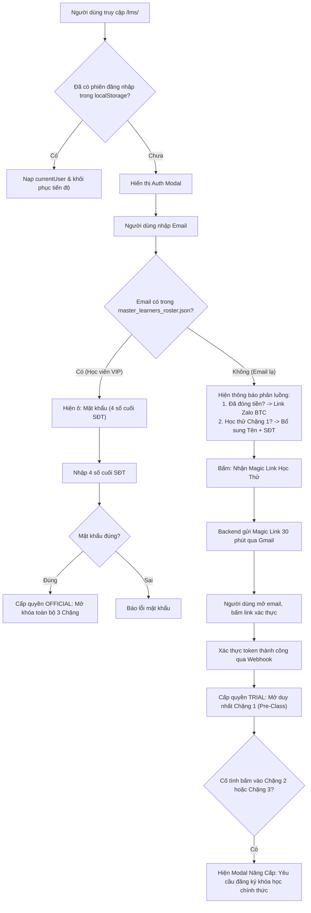

# KẾ HOẠCH TRIỂN KHAI: MÔ HÌNH ĐĂNG NHẬP LAI (HYBRID AUTH MODEL) CHO HỆ THỐNG LMS
**Delivering Happiness Blended Learning LMS Engine**  
**Mã kế hoạch:** `PLAN-20261003-LMS-HYBRID-AUTH`  
**Ngày lập:** 03/10/2026  
**Trạng thái:** Chờ phê duyệt Cấp độ 2 (Awaiting Plan Approval)  

---

## 1. BỐI CẢNH & MỤC TIÊU CỐT LÕI

### A. Vấn Đề Hiện Tại
- Mã nguồn LMS (`lms/app.js` dòng 608–618) đang duy trì nhánh fallback tự phục vụ:
  ```javascript
  if (id.includes("@")) {
      return {
          learner_id: "REG-" + id.split("@")[0].toUpperCase(),
          name: id.split("@")[0],
          email: id,
          cohort: "DHM9-TựPhụcVụ",
          missing_phone: true
      };
  }
  ```
- **Hệ quả**: Bất kỳ người dùng lạ nào trên Internet chỉ cần gõ một email bất kỳ kèm 10 số điện thoại là hệ thống tự động mở cửa cho vào học trọn vẹn Chặng 1, Chặng 2 và Chặng 3 của giáo trình nội bộ mà không cần đóng học phí, không cần xác minh email thật.

### B. Mục Tiêu của Mô Hình Lai (Hybrid Model)
1. **Phân cấp quyền truy cập rõ ràng**:
   - **Học viên Chính thức (Official Learners)**: Có tên trong danh bạ `master_learners_roster.json` ➔ Đăng nhập tức thì trong 3 giây bằng **Email + 4 số cuối SĐT** (Zero Friction, vào học toàn bộ 3 Chặng).
   - **Người mới / Email Lạ (Trial Learners)**: Chưa có tên trong danh bạ ➔ Bắt buộc phải xác thực **Magic Link qua Email thật** ➔ Được cấp quyền **Học thử Chặng 1 (Pre-Class 90 phút)**.
2. **Bảo vệ tuyệt đối bản quyền Chặng 2 & Chặng 3**:
   - Khóa chặt Chặng 2 (Offline Workshop 2 ngày) và Chặng 3 (21 Ngày Hành Động) đối với tài khoản học thử.
   - Khi người học thử cố tình nhấp vào Chặng 2 hoặc Chặng 3, hiển thị Modal chuyển đổi (Conversion Modal) hướng dẫn liên hệ BTC hoặc đăng ký khóa học chính thức.
3. **Thu thập dữ liệu Lead chuẩn xác vào Google Sheet CRM**:
   - Toàn bộ người học thử Chặng 1 qua Magic Link được tự động lưu vào Google Sheet CRM `Delivering Happiness Masterclass CRM` (tab `Leads_Directory` với tag `LMS_TRIAL`) để đội ngũ tư vấn chăm sóc chuyển đổi học viên.

---

## 2. KIẾN TRÚC KỸ THUẬT & DANH MỤC TỆP (ALLOWLIST)

### A. Danh mục tệp trong phạm vi triển khai (Allowlist)
1. `dh4hn-website/lms/index.html`: Cải tiến giao diện Auth Modal và bổ sung Modal thông báo nâng cấp khóa học khi học thử nhấp Chặng 2/3.
2. `dh4hn-website/lms/app.js`: Xóa bỏ lỗ hổng `DHM9-TựPhụcVụ`, cài đặt logic phân luồng (Roster vs Magic Link Trial) và phân quyền vượt chặng (`isStageUnlocked`).
3. `dh4hn-website/Scripts/active_code_gs_final.js`: Thêm cấu hình hỗ trợ `survey_type: "LMS_TRIAL"` vào `AUTH_GATE_CONFIG.SURVEY_CONFIG`.
4. `dh4hn-website/lms/UAT/uat_hybrid_auth_lms.md`: Tài liệu kiểm thử nghiệm thu người dùng (UAT).

### B. Lược đồ Phân Luồng Người Dùng (User Flow)



---

## 3. LỘ TRÌNH 4 PHA TRIỂN KHAI

### 📌 Pha 1: Nâng cấp Backend Apps Script hỗ trợ LMS Trial
- **Mục tiêu**: Hỗ trợ bài khảo sát / định danh loại `LMS_TRIAL` trong `AUTH_GATE_CONFIG.SURVEY_CONFIG`.
- **Nội dung thực hiện**:
  * Thêm cấu hình trong `active_code_gs_final.js`:
    ```javascript
    "LMS_TRIAL": {
      id: "LMS_TRIAL",
      name: "Trải nghiệm Học thử Chặng 1 - Delivering Happiness LMS",
      url: "https://delivering-happiness.vercel.app/lms/",
      tag: "LMS Trial Pre-Class"
    }
    ```
  * Tự động chuyển hướng về `https://delivering-happiness.vercel.app/lms/?token=...&email=...&action=verify` khi nhấp email.

### 📌 Pha 2: Cải tiến Giao diện Auth Modal (`lms/index.html`)
- **Mục tiêu**: Thiết kế màn hình đăng nhập phân luồng rõ ràng, không gây bối rối cho học viên đã đóng tiền và kích thích người mới đăng ký học thử.
- **Nội dung thực hiện**:
  * Khi Email khớp Roster: Hiển thị lời chào cá nhân hóa và ô nhập 4 số cuối SĐT.
  * Khi Email không khớp Roster: Hiển thị 2 khối:
    1. **Khối Học viên đã đăng ký**: Nút kết nối nhanh Zalo / Hotline BTC để được hỗ trợ kích hoạt hồ sơ tức thì.
    2. **Khối Học thử Chặng 1**: Form điền Họ tên, Số điện thoại (10 chữ số) và nút bấm: `Nhận Liên Kết Học Thử 1-Chạm`.
  * Thêm Modal `trial-upgrade-modal`: Nổi bật giao diện Corporate Minimalist Amber thông báo quyền lợi Chặng 2 (Workshop 2 ngày) & Chặng 3 (21 ngày rèn luyện) kèm nút đăng ký khóa học.

### 📌 Pha 3: Cập nhật Logic Xác thực & Phân quyền Vượt chặng (`lms/app.js`)
- **Mục tiêu**: Xóa bỏ hoàn toàn mã tự phục vụ sơ hở, cài đặt cơ chế bảo vệ phân quyền chặt chẽ.
- **Nội dung thực hiện**:
  * Xóa bỏ đoạn `if (id.includes("@"))` tự cấp quyền lớp `DHM9-TựPhụcVụ`.
  * Xử lý query param URL `?token=...&email=...&action=verify`:
    - Gọi API xác thực với Backend Webhook.
    - Nếu hợp lệ: Lưu phiên `currentUser = { role: "trial", isTrial: true, email, phone, name }` vào `localStorage`.
  * Tinh chỉnh hàm `isStageUnlocked(stageIdx)`:
    - Nếu `currentUser.isTrial === true`:
      * `stageIdx === 0` (Chặng 1): Cho phép học bình thường.
      * `stageIdx > 0` (Chặng 2 hoặc 3): Luôn trả về `false` (Khóa cứng).
  * Bắt sự kiện khi người dùng click vào thẻ Chặng 2 hoặc Chặng 3: Nếu là tài khoản `isTrial`, lập tức hiển thị `trial-upgrade-modal`.

### 📌 Pha 4: Kiểm thử Nghiệm thu (UAT) & Triển khai
- **Mục tiêu**: Kiểm chứng toàn diện 4 kịch bản vận hành thực tế.
- **Kịch bản UAT**:
  1. **TC-01 (Học viên chính thức)**: Nhập email có trong roster (`master_learners_roster.json`) + 4 số cuối SĐT ➔ Vào học bình thường, mở khóa cả 3 chặng.
  2. **TC-02 (Email lạ xin học thử)**: Nhập email lạ + SĐT ➔ Nhận email Magic Link ➔ Click link ➔ Vào học Chặng 1 thành công.
  3. **TC-03 (Người học thử truy cập Chặng 2/3)**: Bấm vào bài học Chặng 2/3 ➔ Bị chặn và hiển thị Modal Nâng cấp kèm link đăng ký.
  4. **TC-04 (Kiểm tra ghi nhận dữ liệu CRM)**: Kiểm tra Google Sheet `Delivering Happiness Masterclass CRM` ➔ Dữ liệu học thử xuất hiện trong tab `Leads_Directory` với tag `LMS_TRIAL`.

---

## 4. CHIẾN LƯỢC QUAY LUI (ROLLBACK PLAN)
- Nếu phát sinh lỗi ngoài ý muốn làm gián đoạn học viên đang học:
  1. Khôi phục `lms/app.js` và `lms/index.html` về commit Git hiện tại qua lệnh:
     `git checkout HEAD -- lms/app.js lms/index.html`
  2. Hệ thống quay về trạng thái ổn định hiện tại trong vòng 30 giây.

---

## 5. RANH GIỚI PHÊ DUYỆT (APPROVAL BOUNDARY)
- **Cấp độ 2 (Plan Approval)**: Sếp phê duyệt Kế hoạch triển khai để tiến hành sửa các tệp trong allowlist tại local và chạy kiểm thử.
- **Cấp độ 3 (Risky Operation Approval)**: Chỉ xin lệnh khi commit, push lên remote và deploy Vercel / Clasp.
