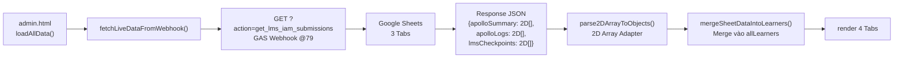

# Implementation Plan: Nâng Cấp Admin Dashboard Thống Nhất 4 Tab — Đồng Bộ Thời Gian Thực Từ Google Sheets (`PLAN-20261011-UNIFIED-DASHBOARD`)

- **Mã kế hoạch (`Plan ID`):** `PLAN-20261011-UNIFIED-DASHBOARD`
- **Ngày lập:** `2026-10-11`
- **Mức độ rủi ro (`Risk Tier`):** `HIGH-RISK` (thay thế hoàn toàn luồng đọc dữ liệu Dashboard từ tệp tĩnh `live_submissions.json` sang gọi API Webhook thời gian thực; bổ sung 2 tab mới; xóa hàm `purgeSimulatedApolloData()` chạy tự động; ảnh hưởng trực tiếp giao diện vận hành của Ban Giảng Huấn).
- **Trạng thái phê duyệt (`Approval Status`):** `⛔ AWAITING PLAN APPROVAL (Cấp độ 2)`

---

## 0. Bối Cảnh & Nguyên Nhân Gốc Rễ (`Context & Root Cause`)

### Tình trạng hiện tại
Admin Dashboard (`admin.html`) hiển thị **0 / 507 HV (0%)** dù học viên đã làm bài Quiz thành công (score 9/10) và hệ thống đã ghi nhận "Đã đồng bộ thành công" lên Google Sheets.

### 3 Nguyên nhân gốc rễ đã xác định

| # | Nguyên nhân | Vị trí | Mức độ |
|---|-------------|--------|--------|
| 1 | `syncLiveSubmissions()` dòng 980: `fetch('live_submissions.json')` — tệp không tồn tại trên Vercel (untracked trong Git), trả về HTTP 404 | `admin.html:980` | CRITICAL |
| 2 | `purgeSimulatedApolloData()` dòng 872-896: chạy tự động mỗi lần mở trang (`loadAllData()` dòng 1119), xóa sạch `testAttempts = []` của tất cả Apollo learner | `admin.html:872-896, 1119` | CRITICAL |
| 3 | `syncLiveSubmissions()` chỉ khớp learner theo `allLearners` đã nạp từ `authorized_roster.json` — Coach/BTC account có thể bị bỏ qua do logic khớp edge case | `admin.html:999-1020` | HIGH |

### Nguyên lý chuẩn (Source of Truth)
> *"Quét đồng bộ danh sách bài nộp từ nguồn Google Sheet vào Dashboard — cái này phải là nguyên lý chuẩn chứ"* — Vũ Hoàng

**Google Sheets là Single Source of Truth** cho mọi dữ liệu học viên. Dashboard PHẢI đọc dữ liệu trực tiếp từ Google Sheets thông qua GAS Webhook endpoint, KHÔNG qua tệp tĩnh JSON hoặc chỉ từ `localStorage` của trình duyệt.

---

## 1. Mục Tiêu & Phạm Vi (`Scope & Objectives`)

### 1.1 Mục tiêu chính

1. **Thay thế `live_submissions.json` bằng API thời gian thực**: Gọi trực tiếp `GET ?action=get_lms_iam_submissions` tới GAS Webhook để lấy dữ liệu từ 3 trang tính Google Sheets.
2. **Xây dựng 2D Array Ingestion Adapter**: Parse mảng 2 chiều cell values từ GAS thành mảng JSON objects có tên trường (`key-value`).
3. **Bổ sung Tab 2 — Thu Hoạch 5 Trạm I•A•M / Team Happiness**: Hiển thị KPI và danh sách chi tiết bài thu hoạch tại 5 Trạm workshop.
4. **Nâng cấp Tab 3 — Hành Trình Blended 360°**: Kết hợp dữ liệu Quiz + Me Values + ABCDE + 5 Trạm I•A•M vào một bảng tổng hợp duy nhất.
5. **Nâng cấp Tab 4 — Báo Cáo Điều Hành & Xuất CSV**: Báo cáo executive summary + xuất CSV chi tiết toàn bộ data.
6. **Bổ sung bộ lọc đa chiều**: Lọc theo 22 Apollo Center, 10 phòng ban, khóa học, trạng thái.
7. **Xóa `purgeSimulatedApolloData()` khỏi `loadAllData()`**: Không còn xóa tự động dữ liệu mỗi lần tải trang.
8. **Auto-refresh toggle**: Tự động cập nhật dữ liệu mỗi 60 giây (tùy chọn bật/tắt).

### 1.2 Phạm vi KHÔNG bao gồm

- KHÔNG sửa Backend GAS (`active_code_gs_final.js`) — endpoint `get_lms_iam_submissions` đã hoạt động đúng.
- KHÔNG sửa logic write path trong `app.js` — đã hoạt động sau Patch 6.
- KHÔNG sửa `team-happiness-iam` source code.

---

## 2. Danh Sách Tệp Được Phép Chỉnh Sửa (`Allowlist` — 2 Tệp)

1. Tệp giao diện Admin Dashboard chính:
```text
c:\Users\vu.hoang\.gemini\antigravity\scratch\dh4hn-website\lms\admin.html
```
[admin.html](file:///c:/Users/vu.hoang/.gemini/antigravity/scratch/dh4hn-website/lms/admin.html)

2. Tệp mirror đồng bộ 100% trong workspace `Teaching DH` (Quy tắc 5 — Holistic Consistency Audit):
```text
c:\Users\vu.hoang\.gemini\antigravity\scratch\Teaching DH\dhm-micro-lms\admin.html
```
[admin.html](file:///c:/Users/vu.hoang/.gemini/antigravity/scratch/Teaching%20DH/dhm-micro-lms/admin.html)

---

## 3. Nguồn Chuẩn Tham Chiếu (`Source of Truth` — Chỉ Đọc)

| Nguồn | Đường dẫn / ID |
|-------|----------------|
| Google Sheet Apollo I•A•M | `1Ju4y-KNDe7eiMvpbyq2mPfKTijH_1NIC3j8Rykl7cak` |
| GAS Webhook Production | `https://script.google.com/macros/s/AKfycbw0vTBMod1rp4f_906BcjwXbPhlb9ltiDiwVPdaOg4fOWZZOlpmy7jp2fOSrETQQe9PZQ/exec` |
| GAS Webhook version | `@79` |
| Roster tĩnh (đối chiếu) | `authorized_roster.json` (507 HV) |

```text
c:\Users\vu.hoang\.gemini\antigravity\scratch\dh4hn-website\Scripts\active_code_gs_final.js
```
[active_code_gs_final.js](file:///c:/Users/vu.hoang/.gemini/antigravity/scratch/dh4hn-website/Scripts/active_code_gs_final.js)

```text
c:\Users\vu.hoang\.gemini\antigravity\scratch\dh4hn-website\lms\authorized_roster.json
```
[authorized_roster.json](file:///c:/Users/vu.hoang/.gemini/antigravity/scratch/dh4hn-website/lms/authorized_roster.json)

---

## 4. Kiến Trúc Kỹ Thuật Mới (`Technical Architecture`)

### 4.1 Luồng Dữ Liệu Đọc Mới (Read Path)



### 4.2 Cấu Trúc 3 Trang Tính Google Sheets

**Tab `Thu Hoạch LMS & Checkpoints` (26 cột):**
Row 0 = headers. Các cột chính: `Timestamp`, `Họ và tên`, `Email`, `Phone`, `Center`, `Department`, `Quiz Score`, `Quiz Total`, `Quiz Passed`, `Quiz Percent`, `Quiz Duration`, `Me Values JSON`, `ABCDE JSON`, `CP1 I/A/M`, `CP2 I/A/M`, `State Hash`, ...

**Tab `Tổng Hợp Học Viên` (31 cột):**
Row 0 = headers. Các cột chính: `Timestamp`, `Họ và tên`, `Email`, `Phone`, `Center`, `Department`, `Trạm 1..5 scores`, `Total IAM Score`, `Reflection I/A/M`, `Quiz Score`, `Quiz Passed`, `Raw Sets JSON`, ...

**Tab `Nhật Ký Từng Trạm` (13 cột):**
Row 0 = headers. Các cột chính: `Timestamp`, `Họ và tên`, `Email`, `Center`, `Station Name`, `Station Score`, `Duration`, `Reflection Text`, ...

### 4.3 2D Array Ingestion Adapter

Backend GAS trả về mảng 2 chiều cell values (`getDataRange().getValues()`), KHÔNG phải JSON objects. Adapter phải:

```javascript
function parse2DArrayToObjects(arr2D) {
    if (!Array.isArray(arr2D) || arr2D.length < 2) return [];
    const headers = arr2D[0].map(h => String(h).trim());
    return arr2D.slice(1).map(row => {
        const obj = {};
        headers.forEach((h, i) => { obj[h] = row[i] !== undefined ? row[i] : ''; });
        return obj;
    }).filter(obj => {
        // Bỏ dòng trống (không có tên hoặc email)
        return (obj['Họ và tên'] || obj['Email'] || obj['Phone'] || '').toString().trim() !== '';
    });
}
```

### 4.4 Cấu Trúc 4 Tab Dashboard

| Tab | Tên | Mô tả | Nguồn dữ liệu |
|-----|-----|--------|----------------|
| 1 | 🎯 Đo Lường Bài Test (>80%) | KPI quiz, funnel, distribution, bảng chi tiết | `lmsCheckpoints` |
| 2 | 🏆 Thu Hoạch 5 Trạm I•A•M | KPI 5 trạm workshop, heatmap hoàn thành, danh sách | `apolloSummary` + `apolloLogs` |
| 3 | 🔄 Hành Trình Blended 360° | Bảng tổng hợp kết hợp Quiz + Values + ABCDE + 5 Trạm | Merge cả 3 sheets |
| 4 | 📊 Báo Cáo & Xuất CSV | Executive KPI summary, xuất CSV tất cả data | Aggregate |

---

## 5. Thiết Kế Chi Tiết Từng Hạng Mục (`Exact Code Changes`)

### PHASE 1: Thay Thế Luồng Đọc Dữ Liệu (CRITICAL)

#### 5.1 Xóa gọi `purgeSimulatedApolloData()` tự động

**Vị trí:** `admin.html` dòng 1119 (trong `loadAllData()`)
**Hành động:** Xóa dòng `purgeSimulatedApolloData();` khỏi luồng tự động. Giữ nguyên hàm để nút "🧹 Dọn Dẹp Mock Data" vẫn hoạt động khi bấm thủ công.

```javascript
// TRƯỚC (dòng 1118-1119):
// Tự động dọn dẹp dữ liệu mô phỏng giả lập cũ của học viên Apollo (nếu có từ trước)
purgeSimulatedApolloData();

// SAU: XÓA 2 dòng trên. Giữ hàm purgeSimulatedApolloData() nguyên bản để nút thủ công vẫn dùng được.
```

#### 5.2 Thay thế `syncLiveSubmissions()` bằng `fetchLiveDataFromWebhook()`

**Vị trí:** Thay toàn bộ hàm `syncLiveSubmissions()` tại dòng 978-1054

**Hằng số Webhook mới (thêm sau dòng ~732):**
```javascript
const WEBHOOK_URL = 'https://script.google.com/macros/s/AKfycbw0vTBMod1rp4f_906BcjwXbPhlb9ltiDiwVPdaOg4fOWZZOlpmy7jp2fOSrETQQe9PZQ/exec';
const WEBHOOK_ACTION = 'get_lms_iam_submissions';
const AUTO_REFRESH_INTERVAL_MS = 60000; // 60 giây
let autoRefreshTimer = null;
let lastFetchTimestamp = null;

// Dữ liệu parsed từ Google Sheets
let parsedLmsCheckpoints = [];
let parsedApolloSummary = [];
let parsedApolloLogs = [];
```

**Hàm mới `fetchLiveDataFromWebhook()`:**
```javascript
async function fetchLiveDataFromWebhook(showAlert = false) {
    const statusEl = document.getElementById('webhook-fetch-status');
    try {
        if (statusEl) {
            statusEl.textContent = '⏳ Đang tải dữ liệu từ Google Sheets...';
            statusEl.className = 'text-xs text-amber-400 animate-pulse';
        }

        const url = `${WEBHOOK_URL}?action=${WEBHOOK_ACTION}&t=${Date.now()}`;
        const res = await fetch(url);

        if (!res.ok) {
            throw new Error(`HTTP ${res.status}: ${res.statusText}`);
        }

        const data = await res.json();
        if (!data || !data.success) {
            throw new Error(data?.error || 'Response không hợp lệ');
        }

        // Parse 2D arrays thành objects
        parsedLmsCheckpoints = parse2DArrayToObjects(data.lmsCheckpoints || []);
        parsedApolloSummary = parse2DArrayToObjects(data.apolloSummary || []);
        parsedApolloLogs = parse2DArrayToObjects(data.apolloLogs || []);

        // Merge vào allLearners
        const mergedCount = mergeSheetDataIntoLearners();
        lastFetchTimestamp = new Date();

        if (statusEl) {
            statusEl.textContent = `✅ Đã tải ${parsedLmsCheckpoints.length} bài Quiz + ${parsedApolloSummary.length} bài I•A•M (${lastFetchTimestamp.toLocaleTimeString('vi-VN')})`;
            statusEl.className = 'text-xs text-emerald-400';
        }

        if (showAlert) {
            alert(`Đã đồng bộ thành công ${mergedCount} kết quả từ Google Sheets!`);
        }
        return mergedCount;
    } catch (err) {
        console.error('fetchLiveDataFromWebhook failed:', err);
        if (statusEl) {
            statusEl.textContent = `❌ Lỗi tải dữ liệu: ${err.message}`;
            statusEl.className = 'text-xs text-red-400';
        }
        if (showAlert) {
            alert(`Lỗi khi đồng bộ từ Google Sheets: ${err.message}`);
        }

        // JSONP Fallback nếu fetch thất bại (CORS)
        return fetchLiveDataViaJsonp(showAlert);
    }
}
```

**Hàm JSONP Fallback:**
```javascript
function fetchLiveDataViaJsonp(showAlert = false) {
    return new Promise((resolve) => {
        const callbackName = 'dh10Jsonp_' + Array.from(crypto.getRandomValues(new Uint8Array(20))).map(b => b.toString(36)).join('').slice(0, 24);
        const script = document.createElement('script');
        const timeoutId = setTimeout(() => {
            cleanup();
            resolve(0);
        }, 15000);

        window[callbackName] = function(data) {
            clearTimeout(timeoutId);
            cleanup();
            if (data && data.success) {
                parsedLmsCheckpoints = parse2DArrayToObjects(data.lmsCheckpoints || []);
                parsedApolloSummary = parse2DArrayToObjects(data.apolloSummary || []);
                parsedApolloLogs = parse2DArrayToObjects(data.apolloLogs || []);
                const count = mergeSheetDataIntoLearners();
                lastFetchTimestamp = new Date();
                resolve(count);
            } else {
                resolve(0);
            }
        };

        function cleanup() {
            delete window[callbackName];
            if (script.parentNode) script.parentNode.removeChild(script);
        }

        script.src = `${WEBHOOK_URL}?action=${WEBHOOK_ACTION}&callback=${callbackName}&t=${Date.now()}`;
        script.onerror = () => { clearTimeout(timeoutId); cleanup(); resolve(0); };
        document.head.appendChild(script);
    });
}
```

#### 5.3 Hàm `parse2DArrayToObjects()` — 2D Array Ingestion Adapter

```javascript
function parse2DArrayToObjects(arr2D) {
    if (!Array.isArray(arr2D) || arr2D.length < 2) return [];
    const headers = arr2D[0].map(h => String(h || '').trim());
    return arr2D.slice(1)
        .map(row => {
            const obj = {};
            headers.forEach((h, i) => {
                obj[h] = (i < row.length) ? row[i] : '';
            });
            return obj;
        })
        .filter(obj => {
            const name = String(obj['Họ và tên'] || '').trim();
            const email = String(obj['Email'] || '').trim();
            const phone = String(obj['Phone'] || obj['Số điện thoại'] || '').trim();
            return name || email || phone;
        });
}
```

#### 5.4 Hàm `mergeSheetDataIntoLearners()` — Merge dữ liệu Sheets vào allLearners

```javascript
function mergeSheetDataIntoLearners() {
    let mergedCount = 0;

    // Merge LMS Checkpoints (Quiz results)
    parsedLmsCheckpoints.forEach(cp => {
        const learner = findLearnerByIdentity(cp);
        if (!learner) return;

        const score = parseInt(cp['Quiz Score'] || cp['score'] || 0, 10);
        const total = parseInt(cp['Quiz Total'] || cp['total'] || 10, 10);
        const percent = total > 0 ? Math.round((score / total) * 100) : 0;
        const passed = (cp['Quiz Passed'] === true || cp['Quiz Passed'] === 'TRUE' || percent >= 80);
        const duration = parseInt(cp['Quiz Duration'] || cp['durationSeconds'] || 0, 10);
        const timestamp = cp['Timestamp'] || new Date().toISOString();

        // High-Water Mark: không ghi đè điểm cao hơn bằng điểm thấp hơn
        const existingBest = learner.bestScore || 0;
        if (percent < existingBest && existingBest > 0) return;

        // Tạo attempt entry
        const attempt = {
            attempt: (learner.testAttempts?.length || 0) + 1,
            score, total, percent,
            passed80: passed,
            durationSeconds: duration,
            timestamp: timestamp
        };

        // De-duplicate: nếu đã có attempt cùng timestamp, bỏ qua
        if (learner.testAttempts?.some(a => a.timestamp === timestamp)) return;

        if (!learner.testAttempts) learner.testAttempts = [];
        learner.testAttempts.push(attempt);
        learner.stage1Passed = learner.testAttempts.some(a => a.passed80);
        learner.completedStagesCount = Math.max(learner.completedStagesCount || 0, learner.stage1Passed ? 1 : 0);

        // Merge Me Values nếu có
        try {
            const valuesJson = cp['Me Values JSON'] || cp['selectedValues'];
            if (valuesJson) {
                const vals = typeof valuesJson === 'string' ? JSON.parse(valuesJson) : valuesJson;
                if (Array.isArray(vals) && vals.length > 0) {
                    if (!learner.data) learner.data = { stageData: {} };
                    if (!learner.data.stageData) learner.data.stageData = {};
                    learner.data.stageData['stage-2'] = { selectedValues: vals };
                    learner.stage2ValuesCount = vals.length;
                    learner.completedStagesCount = Math.max(learner.completedStagesCount, 2);
                }
            }
        } catch (e) { /* JSON parse lỗi, bỏ qua */ }

        // Merge ABCDE nếu có
        try {
            const abcdeJson = cp['ABCDE JSON'] || cp['abcde'];
            if (abcdeJson) {
                const abcde = typeof abcdeJson === 'string' ? JSON.parse(abcdeJson) : abcdeJson;
                if (abcde && abcde.D) {
                    if (!learner.data) learner.data = { stageData: {} };
                    if (!learner.data.stageData) learner.data.stageData = {};
                    learner.data.stageData['stage-3'] = { abcde };
                    learner.stage3AbcdeFilled = true;
                    learner.completedStagesCount = Math.max(learner.completedStagesCount, 3);
                }
            }
        } catch (e) { /* JSON parse lỗi, bỏ qua */ }

        // Merge I•A•M Checkpoints
        ['CP1', 'CP2'].forEach(cpKey => {
            try {
                const iamKey = `${cpKey} I/A/M`;
                const iamData = cp[iamKey];
                if (iamData) {
                    const iam = typeof iamData === 'string' ? JSON.parse(iamData) : iamData;
                    if (!learner.data) learner.data = { stageData: {} };
                    if (!learner.data.stageData) learner.data.stageData = {};
                    const stageKey = cpKey === 'CP1' ? 'stage-1' : 'stage-2';
                    if (!learner.data.stageData[stageKey]) learner.data.stageData[stageKey] = {};
                    learner.data.stageData[stageKey].iam = iam;
                }
            } catch (e) { /* bỏ qua */ }
        });

        learner.coachNotes = `Kết quả thật từ Google Sheet (${percent}%).`;
        mergedCount++;
    });

    // Merge Apollo Summary (5 Trạm I•A•M)
    parsedApolloSummary.forEach(row => {
        const learner = findLearnerByIdentity(row);
        if (!learner) return;

        // Gán dữ liệu 5 Trạm vào learner
        if (!learner.iamStations) learner.iamStations = {};
        for (let i = 1; i <= 5; i++) {
            const stationKey = `Trạm ${i}`;
            const scoreKey = `Station ${i} Score`;
            const val = row[stationKey] || row[scoreKey];
            if (val !== undefined && val !== '') {
                learner.iamStations[`station${i}`] = {
                    score: parseFloat(val) || 0,
                    completed: true
                };
            }
        }
        learner.iamTotalScore = parseFloat(row['Total IAM Score'] || row['Tổng Điểm'] || 0);
        learner.center = row['Center'] || row['Apollo Center'] || learner.center || '';
        learner.department = row['Department'] || row['Phòng ban'] || learner.department || '';
    });

    // Lưu localStorage
    ensureTestMetricsIntegrity();
    updateCohortFilterOptions();
    localStorage.setItem(REGISTRY_KEY, JSON.stringify(allLearners));

    return mergedCount;
}
```

#### 5.5 Hàm `findLearnerByIdentity()` — Khớp đa tầng

```javascript
function findLearnerByIdentity(sheetRow) {
    const sEmail = String(sheetRow['Email'] || '').toLowerCase().trim();
    const sPhone = String(sheetRow['Phone'] || sheetRow['Số điện thoại'] || '').replace(/\s+/g, '').trim();
    const sName = String(sheetRow['Họ và tên'] || sheetRow['name'] || '').toLowerCase().trim();

    // 1. Khớp Email
    if (sEmail) {
        const found = allLearners.find(l => {
            const lEmail = (l.email || (l.identity && l.identity.includes('@') ? l.identity : '')).toLowerCase().trim();
            return lEmail && lEmail === sEmail;
        });
        if (found) return found;
    }

    // 2. Khớp SĐT (>= 8 số)
    if (sPhone && sPhone.length >= 8) {
        const found = allLearners.find(l => {
            const lPhone = (l.phone || (l.identity && !l.identity.includes('@') ? l.identity : '') || '').replace(/\s+/g, '').trim();
            return lPhone && lPhone === sPhone;
        });
        if (found) return found;
    }

    // 3. Khớp Họ tên
    if (sName) {
        return allLearners.find(l => {
            const lName = (l.name || '').toLowerCase().trim();
            return lName && lName === sName;
        });
    }

    return null;
}
```

#### 5.6 Cập nhật `loadAllData()` — Luồng mới

**Vị trí:** `admin.html` dòng 1110-1135

```javascript
// TRƯỚC:
async function loadAllData() {
    try {
        const raw = localStorage.getItem(REGISTRY_KEY);
        allLearners = raw ? JSON.parse(raw) : [];
    } catch (e) {
        allLearners = [];
    }
    purgeSimulatedApolloData();           // ← XÓA
    await syncAndMergeRoster(false);
    await syncLiveSubmissions(false);      // ← THAY THẾ
    syncLocalSessionProgress();
    ensureTestMetricsIntegrity();
    updateCohortFilterOptions();
    renderTestAnalytics();
    renderGeneralDashboard();
}

// SAU:
async function loadAllData() {
    try {
        const raw = localStorage.getItem(REGISTRY_KEY);
        allLearners = raw ? JSON.parse(raw) : [];
    } catch (e) {
        allLearners = [];
    }

    // Bước 1: Nạp roster (507 HV)
    await syncAndMergeRoster(false);

    // Bước 2: Tải dữ liệu thời gian thực từ Google Sheets (thay thế live_submissions.json)
    await fetchLiveDataFromWebhook(false);

    // Bước 3: Đồng bộ bài thi cục bộ (trình duyệt hiện tại)
    syncLocalSessionProgress();

    // Bước 4: Tính toán metrics & render
    ensureTestMetricsIntegrity();
    updateCohortFilterOptions();
    renderTestAnalytics();
    renderIamDashboard();         // Tab 2 mới
    renderBlendedJourney();       // Tab 3 mới
    renderGeneralDashboard();     // Tab 4 (cũ là Tab 2)
}
```

### PHASE 2: Bổ Sung Tab Navigation & HTML Structure

#### 5.7 Cập nhật Tab Navigation

**Vị trí:** `admin.html` dòng 120-150

Thay thế 2 nút tab hiện tại bằng 4 nút tab + thêm thanh trạng thái + toggle auto-refresh:

```html
<div class="flex flex-col sm:flex-row sm:items-center justify-between gap-4 border-b border-brand-border pb-4">
    <div class="flex items-center gap-2 flex-wrap">
        <button id="tab-btn-test-analytics" class="tab-btn active px-4 py-2.5 rounded-xl font-bold text-xs transition-all flex items-center gap-2 bg-gradient-to-r from-brand-orange to-brand-amber text-black shadow-lg" data-pane="pane-test-analytics">
            <span>🎯 Đo Lường Bài Test</span>
            <span id="badge-tested-learners-count" class="px-2 py-0.5 rounded-full bg-black/20 text-black font-mono text-[11px]">0</span>
        </button>
        <button id="tab-btn-iam-stations" class="tab-btn px-4 py-2.5 rounded-xl font-semibold text-xs text-slate-400 hover:text-white hover:bg-brand-card transition-all flex items-center gap-2 border border-transparent" data-pane="pane-iam-stations">
            <span>🏆 Thu Hoạch 5 Trạm I•A•M</span>
            <span id="badge-iam-learners-count" class="px-2 py-0.5 rounded-full bg-brand-surface text-slate-300 font-mono text-[11px]">0</span>
        </button>
        <button id="tab-btn-blended-journey" class="tab-btn px-4 py-2.5 rounded-xl font-semibold text-xs text-slate-400 hover:text-white hover:bg-brand-card transition-all flex items-center gap-2 border border-transparent" data-pane="pane-blended-journey">
            <span>🔄 Hành Trình Blended 360°</span>
        </button>
        <button id="tab-btn-general-progress" class="tab-btn px-4 py-2.5 rounded-xl font-semibold text-xs text-slate-400 hover:text-white hover:bg-brand-card transition-all flex items-center gap-2 border border-transparent" data-pane="pane-general-progress">
            <span>📊 Báo Cáo & Xuất CSV</span>
            <span id="badge-total-registered-count" class="px-2 py-0.5 rounded-full bg-brand-surface text-slate-300 font-mono text-[11px]">0</span>
        </button>
    </div>

    <div class="flex items-center gap-2.5 flex-wrap">
        <!-- Trạng thái fetch -->
        <span id="webhook-fetch-status" class="text-xs text-slate-500"></span>

        <!-- Toggle Auto-refresh -->
        <label class="flex items-center gap-1.5 cursor-pointer">
            <input type="checkbox" id="toggle-auto-refresh" class="sr-only peer">
            <div class="relative w-9 h-5 bg-brand-card rounded-full peer peer-checked:bg-emerald-600 transition-colors border border-brand-border">
                <div class="absolute left-0.5 top-0.5 w-4 h-4 bg-slate-300 rounded-full peer-checked:translate-x-4 transition-transform"></div>
            </div>
            <span class="text-xs text-slate-400">Tự động 60s</span>
        </label>

        <!-- Nút đồng bộ thủ công -->
        <button id="btn-sync-live-sheet" class="px-3.5 py-2 rounded-xl bg-emerald-600/20 hover:bg-emerald-600/30 text-emerald-300 text-xs font-semibold border border-emerald-500/30 transition-all flex items-center gap-1.5 shadow-sm">
            <span>📥 Tải KQ Thật Từ Sheet</span>
        </button>

        <a href="https://docs.google.com/spreadsheets/d/1Ju4y-KNDe7eiMvpbyq2mPfKTijH_1NIC3j8Rykl7cak/edit" target="_blank" class="px-3.5 py-2 rounded-xl bg-green-600/20 hover:bg-green-600/30 text-green-400 text-xs font-semibold border border-green-500/30 transition-colors flex items-center gap-1.5">
            <span>📊 Google Sheet ↗</span>
        </a>
    </div>
</div>
```

#### 5.8 Tab Switching Logic (thay thế dòng 711-729)

```javascript
// Generic Tab Switching
const allTabBtns = document.querySelectorAll('.tab-btn');
const allPanes = document.querySelectorAll('[id^="pane-"]');

allTabBtns.forEach(btn => {
    btn.addEventListener('click', () => {
        const targetPane = btn.dataset.pane;

        // Reset all tabs
        allTabBtns.forEach(b => {
            b.className = 'tab-btn px-4 py-2.5 rounded-xl font-semibold text-xs text-slate-400 hover:text-white hover:bg-brand-card transition-all flex items-center gap-2 border border-transparent';
        });

        // Activate clicked tab
        btn.className = 'tab-btn active px-4 py-2.5 rounded-xl font-bold text-xs transition-all flex items-center gap-2 bg-gradient-to-r from-brand-orange to-brand-amber text-black shadow-lg';

        // Show/hide panes
        allPanes.forEach(p => p.classList.add('hidden'));
        const pane = document.getElementById(targetPane);
        if (pane) pane.classList.remove('hidden');
    });
});
```

#### 5.9 Auto-Refresh Toggle Logic

```javascript
const toggleAutoRefresh = document.getElementById('toggle-auto-refresh');
if (toggleAutoRefresh) {
    toggleAutoRefresh.addEventListener('change', () => {
        if (toggleAutoRefresh.checked) {
            autoRefreshTimer = setInterval(async () => {
                await fetchLiveDataFromWebhook(false);
                renderTestAnalytics();
                renderIamDashboard();
                renderBlendedJourney();
                renderGeneralDashboard();
            }, AUTO_REFRESH_INTERVAL_MS);
        } else {
            if (autoRefreshTimer) {
                clearInterval(autoRefreshTimer);
                autoRefreshTimer = null;
            }
        }
    });
}
```

### PHASE 3: Tab 2 — Thu Hoạch 5 Trạm I•A•M

#### 5.10 HTML Section cho Tab 2

Thêm sau `</section>` của `pane-test-analytics` (sau dòng ~435):

```html
<section id="pane-iam-stations" class="space-y-8 hidden">
    <!-- KPI Cards: Tổng HV đã làm, Trạm hoàn thành nhiều nhất, Điểm TB, Trạm cần hỗ trợ -->
    <div class="grid grid-cols-1 sm:grid-cols-2 lg:grid-cols-4 gap-4">
        <div class="p-5 rounded-2xl bg-brand-surface border border-brand-border space-y-1.5 shadow-lg">
            <div class="text-[11px] text-slate-400 font-medium uppercase tracking-wider">HV Đã Tham Gia Workshop</div>
            <div class="flex items-baseline gap-2">
                <span id="iam-kpi-total" class="text-2xl lg:text-3xl font-extrabold text-white">0</span>
                <span id="iam-kpi-total-of" class="text-xs text-slate-500 font-mono">/ 0 HV Apollo</span>
            </div>
        </div>
        <div class="p-5 rounded-2xl bg-brand-surface border border-brand-border space-y-1.5 shadow-lg">
            <div class="text-[11px] text-slate-400 font-medium uppercase tracking-wider">Hoàn Thành Đủ 5 Trạm</div>
            <span id="iam-kpi-full5" class="text-2xl lg:text-3xl font-extrabold text-emerald-400">0</span>
        </div>
        <div class="p-5 rounded-2xl bg-brand-surface border border-brand-border space-y-1.5 shadow-lg">
            <div class="text-[11px] text-slate-400 font-medium uppercase tracking-wider">Điểm I•A•M Trung Bình</div>
            <span id="iam-kpi-avg-score" class="text-2xl lg:text-3xl font-extrabold text-brand-amber">0</span>
        </div>
        <div class="p-5 rounded-2xl bg-brand-surface border border-brand-border space-y-1.5 shadow-lg">
            <div class="text-[11px] text-slate-400 font-medium uppercase tracking-wider">Trạm Cần Hỗ Trợ Nhiều Nhất</div>
            <span id="iam-kpi-weakest" class="text-lg font-bold text-rose-400">—</span>
        </div>
    </div>

    <!-- Heatmap 5 Trạm -->
    <div class="p-6 rounded-2xl bg-brand-surface border border-brand-border">
        <h3 class="text-sm font-bold text-white mb-4">📊 Tỷ Lệ Hoàn Thành Theo Trạm</h3>
        <div id="iam-station-heatmap" class="grid grid-cols-5 gap-3"></div>
    </div>

    <!-- Bộ lọc -->
    <div class="flex items-center gap-3 flex-wrap">
        <select id="iam-filter-center" class="bg-brand-card border border-brand-border rounded-xl px-3 py-2 text-xs text-slate-300 focus:outline-none focus:border-brand-amber">
            <option value="all">Tất cả Center</option>
        </select>
        <select id="iam-filter-department" class="bg-brand-card border border-brand-border rounded-xl px-3 py-2 text-xs text-slate-300 focus:outline-none focus:border-brand-amber">
            <option value="all">Tất cả Phòng ban</option>
        </select>
        <input id="iam-search-input" type="text" placeholder="Tìm theo tên, email, SĐT..." class="bg-brand-card border border-brand-border rounded-xl px-3 py-2 text-xs text-slate-300 w-64 focus:outline-none focus:border-brand-amber" />
    </div>

    <!-- Bảng danh sách -->
    <div class="overflow-x-auto rounded-2xl border border-brand-border">
        <table class="w-full text-left text-sm">
            <thead class="bg-brand-card/60 text-xs text-slate-400 uppercase">
                <tr>
                    <th class="p-4">Họ và tên</th>
                    <th class="p-4">Center</th>
                    <th class="p-4">Trạm 1</th>
                    <th class="p-4">Trạm 2</th>
                    <th class="p-4">Trạm 3</th>
                    <th class="p-4">Trạm 4</th>
                    <th class="p-4">Trạm 5</th>
                    <th class="p-4">Tổng Điểm</th>
                </tr>
            </thead>
            <tbody id="iam-table-body" class="divide-y divide-brand-border/50"></tbody>
        </table>
        <div id="iam-table-empty" class="hidden p-8 text-center text-slate-500 text-sm">Chưa có dữ liệu Workshop I•A•M.</div>
    </div>
</section>
```

#### 5.11 Hàm `renderIamDashboard()`

```javascript
function renderIamDashboard() {
    const apolloLearners = allLearners.filter(l => l.iamStations && Object.keys(l.iamStations).length > 0);
    const totalApollo = allLearners.filter(l => (l.cohort || '').includes('Apollo')).length;

    // KPI
    document.getElementById('iam-kpi-total').textContent = apolloLearners.length;
    document.getElementById('iam-kpi-total-of').textContent = `/ ${totalApollo} HV Apollo`;

    const full5 = apolloLearners.filter(l => Object.keys(l.iamStations).length >= 5).length;
    document.getElementById('iam-kpi-full5').textContent = full5;

    const scores = apolloLearners.map(l => l.iamTotalScore || 0).filter(s => s > 0);
    const avgScore = scores.length > 0 ? (scores.reduce((a, b) => a + b, 0) / scores.length).toFixed(1) : 0;
    document.getElementById('iam-kpi-avg-score').textContent = avgScore;

    // Trạm yếu nhất
    const stationCounts = [0, 0, 0, 0, 0];
    apolloLearners.forEach(l => {
        for (let i = 1; i <= 5; i++) {
            if (l.iamStations[`station${i}`]?.completed) stationCounts[i - 1]++;
        }
    });
    if (apolloLearners.length > 0) {
        const minIdx = stationCounts.indexOf(Math.min(...stationCounts));
        document.getElementById('iam-kpi-weakest').textContent = `Trạm ${minIdx + 1} (${stationCounts[minIdx]} HV)`;
    }

    // Heatmap
    const heatmapEl = document.getElementById('iam-station-heatmap');
    if (heatmapEl) {
        heatmapEl.innerHTML = '';
        for (let i = 0; i < 5; i++) {
            const pct = totalApollo > 0 ? Math.round((stationCounts[i] / totalApollo) * 100) : 0;
            const colorClass = pct >= 80 ? 'bg-emerald-500/20 text-emerald-400 border-emerald-500/30' :
                               pct >= 50 ? 'bg-amber-500/20 text-amber-400 border-amber-500/30' :
                               'bg-rose-500/20 text-rose-400 border-rose-500/30';
            heatmapEl.innerHTML += `
                <div class="p-4 rounded-xl ${colorClass} border text-center">
                    <div class="text-2xl font-extrabold">${pct}%</div>
                    <div class="text-xs mt-1">Trạm ${i + 1}</div>
                    <div class="text-[10px] opacity-70">${stationCounts[i]} HV</div>
                </div>
            `;
        }
    }

    // Badge
    const badge = document.getElementById('badge-iam-learners-count');
    if (badge) badge.textContent = `${apolloLearners.length} HV`;

    // TODO: render bảng chi tiết (tương tự renderTestTable)
    renderIamTable(apolloLearners);
}
```

### PHASE 4: Tab 3 — Hành Trình Blended 360° & Bộ Lọc Đa Chiều

#### 5.12 Hàm `renderBlendedJourney()`

Tab này kết hợp dữ liệu từ cả Quiz (Tab 1) và 5 Trạm I•A•M (Tab 2) vào một bảng tổng hợp duy nhất cho mỗi học viên. Thiết kế chi tiết HTML + render logic tương tự pattern đã có, tham chiếu `renderTestTable()` và `renderGeneralTable()`.

#### 5.13 Bộ lọc đa chiều

Thêm dropdown `<select>` cho:
- **Center:** Lấy unique values từ `learner.center` (22 Apollo centers)
- **Phòng ban:** Lấy unique values từ `learner.department` (10 phòng ban)
- **Khóa học:** Đã có `updateCohortFilterOptions()`
- **Trạng thái:** Đã test / Chưa test / Đạt / Cần hỗ trợ

### PHASE 5: Cập Nhật Nút Sync & Dọn Dẹp

#### 5.14 Cập nhật event listener nút "📥 Tải KQ Thật Từ Sheet"

**Vị trí:** `admin.html` dòng 1593-1602

```javascript
// TRƯỚC: await syncLiveSubmissions(true);
// SAU:
if (btnSyncLiveSheet) {
    btnSyncLiveSheet.addEventListener('click', async () => {
        const origHtml = btnSyncLiveSheet.innerHTML;
        btnSyncLiveSheet.innerHTML = '<span>⏳ Đang tải...</span>';
        btnSyncLiveSheet.disabled = true;
        await fetchLiveDataFromWebhook(true);
        renderTestAnalytics();
        renderIamDashboard();
        renderBlendedJourney();
        renderGeneralDashboard();
        btnSyncLiveSheet.innerHTML = origHtml;
        btnSyncLiveSheet.disabled = false;
    });
}
```

#### 5.15 Xóa tệp `live_submissions.json`

Tệp `live_submissions.json` sẽ KHÔNG cần thiết nữa. Sau khi triển khai thành công, có thể xóa hoặc đổi tên thành `live_submissions.json.deprecated`.

---

## 6. Quy Tắc An Toàn & Ràng Buộc (`Safety Rules & Constraints`)

1. **KHÔNG sửa Backend GAS**: Endpoint `get_lms_iam_submissions` tại `active_code_gs_final.js:4239-4274` và routing tại dòng 984-991 đã hoạt động đúng. Không chạm vào.
2. **KHÔNG hardcode PII**: Không ghi cứng email, SĐT, tên thật học viên trong code.
3. **Giữ `purgeSimulatedApolloData()` cho nút thủ công**: Chỉ xóa lời gọi tự động trong `loadAllData()`.
4. **High-Water Mark**: Khi merge, KHÔNG để điểm thấp ghi đè điểm cao (`percent < existingBest`).
5. **De-duplicate attempts**: Kiểm tra `timestamp` trùng trước khi thêm attempt mới.
6. **JSONP Fallback**: Nếu `fetch` thất bại (CORS), tự động dùng JSONP. Callback name phải match `CALLBACK_REGEX`: `/^dh(?:m8|9|10)Jsonp_[A-Za-z0-9]{16,40}$/`
7. **UTF-8 BOM cho CSV Export**: Giữ nguyên pattern `\uFEFF` đã có.
8. **Mirror Holistic**: Sau khi sửa `dh4hn-website/lms/admin.html`, phải copy 100% sang `Teaching DH/dhm-micro-lms/admin.html`.

---

## 7. Kịch Bản Kiểm Thử Nghiệm Thu (`UAT Scenarios`)

| # | Kịch bản | Kết quả mong đợi | Surface |
|---|----------|-------------------|---------|
| 1 | Mở `admin.html`, nhập PIN, chờ tải xong | KPI hiển thị số HV đã test > 0 (không còn 0/507) | UI DOM |
| 2 | Kiểm tra thanh trạng thái | Hiện "✅ Đã tải X bài Quiz + Y bài I•A•M (HH:MM:SS)" | UI DOM |
| 3 | Bấm Tab "🏆 Thu Hoạch 5 Trạm I•A•M" | Tab 2 hiện lên, KPI + heatmap 5 trạm + bảng danh sách | UI DOM |
| 4 | Bấm Tab "🔄 Hành Trình Blended 360°" | Tab 3 hiện bảng tổng hợp Quiz + 5 Trạm | UI DOM |
| 5 | Bật toggle "Tự động 60s", chờ >60s | Dashboard tự cập nhật, không F5 | UI DOM + Network |
| 6 | Lọc theo Center "Apollo Center 1" | Chỉ hiện HV thuộc center đó | UI DOM |
| 7 | F5 nhiều lần | Dữ liệu Apollo KHÔNG bị reset về 0 (purge đã tắt) | UI DOM |
| 8 | Xuất CSV Tab 1 | File CSV có UTF-8 BOM, dữ liệu đúng | File output |
| 9 | Console không có lỗi `live_submissions.json 404` | Fetch trỏ tới Webhook thay vì file tĩnh | Dev Console |
| 10 | Network tab: chỉ có 1 request tới GAS endpoint | Không fetch `live_submissions.json` | Network |

---

## 8. Kế Hoạch Quay Lui (`Rollback Plan`)

1. **Backup trước khi sửa:** `copy admin.html admin.html.bak.20261011`
2. **Git revert:** `git checkout HEAD -- lms/admin.html` nếu cần
3. **Hàm `purgeSimulatedApolloData()` giữ nguyên:** Chỉ bỏ gọi tự động, nút thủ công vẫn hoạt động để dọn mock data
4. **JSONP fallback:** Nếu `fetch` lỗi CORS, tự động chuyển sang JSONP — không bị treo

---

## 9. Thứ Tự Triển Khai (`Implementation Order`)

1. ✅ **Phase 1** (CRITICAL): Thay thế luồng đọc — `fetchLiveDataFromWebhook()` + adapter + merge + xóa purge tự động
2. ✅ **Phase 2**: Cập nhật tab navigation 4 tabs + auto-refresh toggle
3. ✅ **Phase 3**: Tab 2 HTML + `renderIamDashboard()`
4. ✅ **Phase 4**: Tab 3 Blended Journey + bộ lọc đa chiều
5. ✅ **Phase 5**: Cập nhật event listeners + dọn dẹp

Mỗi Phase phải **UAT local** trước khi sang Phase tiếp theo. Không commit/push cho tới khi tất cả 5 Phase đều pass UAT local.
